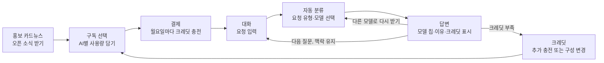

# Siempre PRD02 — AI 통합 구독 서비스 MVP

> 버전: PRD02 · 작성일 2026-11-05 · 작성자 김형민
> 근거: Figma `siempre` 파일의 **확정용** 페이지(서비스 화면 4개, 카드뉴스 6장). PRD01을 이 화면에 맞춰 고친 버전이다.

## PRD01에서 바뀐 점

| 항목 | PRD01 | PRD02 |
| --- | --- | --- |
| 입점 AI | ChatGPT, Claude, Gemini, 음성(ElevenLabs), 이미지 5종 | **GPT, Qwen, Mistral 3종** |
| GPT를 고른 이유 | — | 이미지 생성까지 되는 모델이 필요해서 Claude 대신 GPT를 넣음 |
| 묶음 할인 | 3개 이상 5% | **2개 5%, 3개 10%** |
| 크레딧 지급 | 매주 나눠 지급 | **매주 월요일 충전**, 이월 없음, 추가 충전 가능 |
| 크레딧 차감 | 미정 | **요청 유형별 고정 차감**(1·2·5·19크레딧, 가벼운 대화는 무제한) |
| 화면 | 구독 구성, 결제, 통합 채팅 | **대화, 구독 선택, 크레딧, 관리자** + 홍보 카드뉴스 |
| 가격 기준 | 공식 구독 대비 할인 | 2026년 11월 API 단가, 환율 ₩1,480 기준 |

## 개요

Siempre는 GPT, Qwen, Mistral 중 쓸 AI만 장바구니처럼 골라 담고, 한 대화창에서 요청마다 알맞은 모델이 자동으로 답하는 AI 통합 구독 서비스다.

- 담은 사용량은 **하나의 크레딧 지갑**으로 합쳐지고, 고른 AI 어디에나 나눠 쓴다.
- 가벼운 대화는 가장 싼 모델(Mistral)이 처리해 크레딧을 쓰지 않는다.
- 핵심 메시지: "AI 구독, 이제 골라 쓰세요 — 안 쓰는 AI엔 0원."

## 문제와 타깃 사용자

| 문제 |
| --- |
| AI를 따로 구독하면 매달 고정비가 쌓이는데 다 쓰지 못한다 |
| 다른 AI로 옮길 때마다 같은 말을 다시 붙여넣는다 |
| 어떤 AI를 쓸지 매번 고민한다 |

**초기 타깃**(서비스 소개서): 여러 AI를 동시에 쓰는 대학생, 1인 크리에이터, 마케터. 대화 화면 예시도 소상공인 마케팅(비건 베이커리 신메뉴 홍보, 쇼츠 대본, 상세페이지 카피, 보도자료 번역)이다.

## 입점 AI와 요금

| AI | 모델 | 강점 | 라이트 | 스탠다드 | 헤비 |
| --- | --- | --- | --- | --- | --- |
| GPT | GPT-6 Sol 대화 · GPT-6 Astra 고난도 | 글쓰기 · 이미지 생성 | ₩8,900 (대화 150회, 고난도 5회) | ₩17,900 (300회, 10회) | ₩44,900 (700회, 30회) |
| Qwen | Qwen3.7-Plus 대화 · Qwen3.7-Max 고난도 | 가성비 · 다국어 | ₩2,900 (300회, 10회) | ₩7,900 (800회, 30회) | ₩19,900 (2,000회, 80회) |
| Mistral | Mistral Small 4 대화 · Mistral Large 3 고난도 | 가장 저렴 | ₩1,900 (500회, 20회) | ₩5,500 (1,500회, 50회) | ₩14,900 (4,000회, 150회) |

- 가격은 월 기준, 부가세 포함. 2026년 11월 API 단가와 환율 ₩1,480 기준이다.
- **묶음 할인**: 2개 담으면 5%, 3개 모두 담으면 10%.
- **예시 구성**: GPT 스탠다드 ₩17,900 + Qwen 라이트 ₩2,900 + Mistral 스탠다드 ₩5,500 = ₩26,300 − 10% ₩2,630 = **월 ₩23,670, 매주 약 658크레딧**.
- GPT 스탠다드는 공식 ChatGPT Plus(약 ₩29,000)보다 매달 ₩11,100 싸다.

## 크레딧 정책

- 월 구독료만큼의 크레딧을 **매주 월요일**에 채워 준다. 남은 크레딧은 일요일 자정에 사라지고 다음 주로 넘어가지 않는다.
- 크레딧이 모자라면 **추가 충전**할 수 있다.
- 요청 유형마다 차감 크레딧이 정해져 있고, 보내기 전에 입력창에서 예상 차감량을 보여 준다(예: "예상: 글쓰기 · 5크레딧").

| 요청 유형 | 기본 모델 | 대체 모델 | 차감 크레딧 |
| --- | --- | --- | --- |
| 가벼운 대화 | Mistral Small 4 | Qwen3.7-Plus | 무제한(하루 300회) |
| 요약·번역·다국어 | Qwen3.7-Plus | Mistral Small 4 | 1 |
| 대량 처리·가성비 고난도 | Mistral Large 3 | Qwen3.7-Max | 2 |
| 글쓰기·일반 질문 | GPT-6 Sol | Qwen3.7-Plus | 5 |
| 고난도 추론·코딩 | GPT-6 Astra | Qwen3.7-Max | 19 |

## MVP 기능 요구사항

| 화면 | 요구사항 | 우선순위 |
| --- | --- | --- |
| 구독 선택(장바구니) | AI 3종마다 안 씀·라이트·스탠다드·헤비 중 하나를 고른다. 고를 때마다 오른쪽 장바구니의 항목, 묶음 할인, 월 결제액, 주간 크레딧이 바로 바뀐다. AI 카드마다 공식 구독 대비 절약액을 보여 준다. | P0 |
| 결제 | 장바구니 구성으로 월 구독을 결제한다. | P0 |
| 대화 | 한 대화창에서 요청을 분류해 알맞은 모델로 보낸다. 모델이 바뀌어도 앞 대화 맥락을 이어받는다. | P0 |
| 대화 | 답변마다 모델 칩(모델별 색), 선택 이유, 차감 크레딧을 보여 준다. 예: "글쓰기 요청이라 자동 선택 · 5크레딧" | P0 |
| 대화 | "다른 모델로 다시 받기"로 같은 질문을 다른 모델에게 다시 받는다. | P0 |
| 대화 | 입력창에 예상 요청 유형과 차감 크레딧을 미리 보여 준다. 파일 첨부 버튼이 있다. | P1 |
| 대화 | 사이드바에 대화 기록(오늘·지난 7일), 이번 주 크레딧 막대, 요금제 링크, 구독 중인 AI 로고를 둔다. | P1 |
| 크레딧 | 이번 주 남은 크레딧과 주간 지급량, 다음 충전일, 추가 충전 버튼을 보여 준다. | P0 |
| 크레딧 | 이번 주 가벼운 대화 횟수, 요청 유형별 사용량, 최근 기록(시간·작업·모델·크레딧) 표를 보여 준다. | P1 |
| 관리자 | 베타 지표 5개, 라우팅 규칙 표(규칙별 켜기·끄기), 비용 안전장치, 손익 기준선을 본다. | P1 |

## 비용 안전장치

- 요청 1건 원가가 **₩500**을 넘으면 더 저렴한 모델로 다시 보낸다.
- 사용자 1명의 하루 원가가 **₩3,000**을 넘으면 관리자에게 알린다.
- 가벼운 대화는 하루 **300회**까지.
- 요청 분류는 Mistral Small 4가 맡고, 공급사 장애 시 대체 모델로 자동 전환한다.

## 목표와 성공 지표

베타는 아직 시작 전이라 실측값은 없다. 관리자 화면의 목표값은 다음과 같다.

| 지표 | 목표 | 확인하려는 것 |
| --- | --- | --- |
| 다른 모델로 다시 받기 비율 | 10% 이하 | 자동 라우팅을 믿는지 |
| 4주 차 재방문율 | 30% 이상 | 계속 쓰는지 |
| 무료→유료 전환율 | 5% | 돈을 내는지 |
| 크레딧 사용률 | 50~70% | 수익 구조가 맞는지 |
| 유료 1인당 월 API 원가 | ₩13,000 이하 | 원가가 맞는지 |

**손익 기준선**(손익 추정 시트 기본 시나리오): 손익분기 유료 가입자 약 6,900명, 유료 1인 월 API 원가 ₩13,000 이하, 크레딧 사용률 65% 가정, 무료 1인 월 원가 ₩100 가정.

## 사용자 흐름

## 홍보 카드뉴스 (6장)

| 장 | 메시지 |
| --- | --- |
| 1 Cover | AI 구독료로 매달 11만 원 내세요? (공식 구독 5개 합계 ₩116,700) |
| 2 문제 | 구독은 3개, 쓰는 건 절반 — 반복·비용·고민 |
| 3 입점 AI | 딱 3종: GPT(글쓰기·코딩 만능), Mistral(빠르고 가벼운 답변), Qwen(다국어·코딩 가성비) |
| 4 장바구니 | 쓸 AI 고르기 → 사용량 고르기 → 월 요금 바로 확인. 안 쓰는 AI엔 0원 |
| 5 한 대화 | 질문에 맞는 AI 추천, 앞 대화 그대로, 지금 쓰는 AI를 색으로. "Qwen 초안 → GPT 마무리" |
| 6 Closing | OPEN SOON — 저장해두고 오픈 소식 먼저 받기 |

## 범위 밖

- 음성 생성(ElevenLabs) 등 3종 외 AI
- 한 질문에 여러 모델이 동시에 답하는 병렬 비교
- 다른 서비스에 들어가는 플러그인 형태

## 리스크

- 크레딧 사용률이 100%에 가까워지면 적자가 난다. 주간 충전과 이월 없음이 수익 구조의 핵심이다.
- 모델을 바꿀 때 앞 대화 기록을 새 모델에 다시 보내야 해서 토큰 비용이 늘어난다.
- GPT-6 Astra(19크레딧)를 많이 쓰는 사용자는 원가가 빠르게 오른다. 요청당 ₩500 상한이 이를 막는 장치다.
- 국내에는 여러 AI를 무료로 모은 서비스(뤼튼)가 있다. 차별점은 자동 라우팅과 쓰는 만큼 내는 구조다.

## 열린 질문

- [ ] **이미지 생성의 라우팅 규칙과 차감 크레딧이 없다.** GPT를 넣은 이유가 이미지 생성인데, 라우팅 표에 이미지 요청 유형이 빠져 있다.
- [ ] **표기 통일:** GPT 강점이 구독 화면에는 "글쓰기 · 이미지 생성", 카드뉴스 3장에는 "글쓰기·코딩 만능"으로 다르다.
- [ ] **카드뉴스 1장 비교 대상:** 공식 구독 5개(ChatGPT, Claude, Google AI, 이미지 AI, ElevenLabs) 합계와 비교하는데, Siempre는 3종만 제공한다. 같은 조건의 비교인지 정리가 필요하다.
- [ ] **GPT 가격 근거:** GPT 단계별 가격은 PRD01 시안 가격을 옮겨 온 것이라, "API 단가 기준"으로 다시 계산해야 한다.
- [ ] **요청당 차감 크레딧(1·2·5·19)이 실제 API 원가와 맞는지** 검증이 필요하다.
- [ ] **서비스 이름:** 화면에 [Siempre]처럼 대괄호로 표기돼 있어 확정 여부가 불분명하다.
- [ ] 주 타깃은 헤비 유저인가, 라이트 유저인가?
- [ ] 자동 라우팅이 구독하지 않은 AI가 더 맞다고 판단하면 어떻게 하나? (추천만 보여 줄지, 구독 추가를 제안할지)
