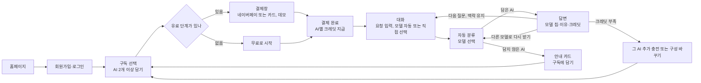

# Siempre MVP PRD

> 버전: PRD03 · 작성일 2026-11-09 · 상태: 검토 중
> 근거: Siempre MVP PRD(수정본), 구독 선택 화면 시안, 유튜버 사용 시나리오, 상세 페르소나, SWOT, 화면 리뷰(2026-11-09)

## 목차

1. 개요
2. 사용자
3. 목표와 성공 지표
4. 입점 AI
5. 요금 정책
6. 크레딧 정책
7. MVP 기능 요구사항
8. 사용자 흐름
9. 범위 밖
10. 리스크와 대응
11. 출시 전 확인
12. 열린 질문

---

## 1. 개요

### 1-1. 서비스 정의

Siempre는 프롬프트를 넣으면 Claude, Qwen, Mistral, Nano Banana 중 알맞은 AI를 자동으로 골라, 한 대화에서 글·번역·이미지 작업을 끝내 주는 **웹 서비스**다. 음성 생성(ElevenLabs)은 MVP 다음에 추가한다.

- 사용자는 쓸 AI를 장바구니처럼 골라 담고, AI마다 무료·라이트·스탠다드·헤비 중 하나를 고른다.
- 대화할 때는 요청 유형에 따라 담아 둔 AI 중 알맞은 모델이 자동으로 답한다. 원하면 보내기 전에 모델을 직접 고를 수도 있다.

### 1-2. 해결할 문제

| 문제 | 지금의 모습 |
| --- | --- |
| 구독료가 겹친다 | AI마다 따로 구독해 매달 고정비가 쌓이는데, 각 서비스를 다 쓰지 못한다 |
| 작업이 끊긴다 | 대본은 한 AI, 번역은 다른 AI, 이미지는 또 다른 곳에서 만들며 같은 내용을 다시 붙여 넣는다 |
| 고르기 어렵다 | 작업마다 어떤 AI가 나은지 매번 직접 판단해야 한다 |

### 1-3. 핵심 메시지

"쓸 AI만 골라 담고, 고르는 건 Siempre가 할게요."

---

## 2. 사용자

### 2-1. 타깃 사용자

여러 AI를 작업마다 바꿔 쓰거나, 두 개 이상을 결제하고 있는 사람. 아래는 모두 인터뷰로 검증할 가설이다.

| 사용자 | 이어지는 작업 | 꼭 필요한 경험 | 검증 순서 |
| --- | --- | --- | --- |
| 1인 크리에이터·유튜버 | 대본 → (음성) → 썸네일 | 수정한 내용이 다음 결과물에도 이어짐, 수정할 때마다 드는 비용 확인 | 1 |
| 마케터 | 캠페인 카피 → 이미지 → 번역 | 브랜드 말투·행사 조건 유지, 반복 수정 비용 | 2 |
| 프리랜서 작가·디자이너 | 고객 브리프 → 카피·시안 → 수정 | 이전 승인 조건 유지, 다시 받기 추가 차감 이해 | 2 |
| 대학생 | 자료 요약 → 이해 → 발표 초안 | 무료로 시작, 무료 한도와 추가 비용 안내 | 3 |
| 직장인 | 회의 메모 → 보고서 → 메일 | 항목·수치 누락 없음, 깊은 검토 선택 | 3 |
| 소상공인 | 홍보 문구 → 포스터 → 리뷰 답글 | 쉬운 구성 선택, 주간 소멸 안내, 모바일에서 이미지 내려받기 | 3 |
| 온라인 판매자·다국어 사용자 | 상품 설명 → 번역 → 문의 답변 | 숫자·단위 보존, 낮은 반복 비용 | 3 |

인터뷰는 1인 유튜버부터 시작하고, 마케터·디자이너로 작업 맥락 유지가 반복되는지 확인한다. 참여자는 최근 실제 작업에서 AI를 2개 이상 써 본 사람으로 한다.

### 2-2. 대표 페르소나

**김도윤 (29세, 1인 유튜버, 가상 인물)**
- 생활 경제 채널 운영, 구독자 3만 명, 주 2회 업로드
- 불편: 대본을 복사해 다른 서비스에 붙이고, 썸네일 문구를 다시 정리해 이미지 서비스에 입력함. 대본을 고치면 다른 결과물에 옛 내용이 남음
- 원하는 것: 대본이 정해지면 같은 대화에서 번역과 썸네일까지 나오는 것, 수정할 때 비용이 얼마나 드는지 미리 아는 것

### 2-3. 대표 시나리오

1. Claude 스탠다드, Qwen 라이트, Nano Banana 라이트를 담는다.
2. "8분 유튜브 대본 써줘" → 글쓰기로 분류, **Claude**가 답한다.
3. "도입부 영어로 번역해줘" → 번역으로 분류, **Qwen**이 이어서 답한다.
4. "이 영상 썸네일 3개" → 이미지로 분류, **Nano Banana**가 앞 대본 주제를 반영해 만든다.
5. "고마워" → 가벼운 대화, **Mistral**이 답하고 크레딧은 쓰지 않는다.

---

## 3. 목표와 성공 지표

비공개 베타(100~300명, 4주)에서 네 가지 가설을 확인한다.

| 가설 | 지표 | 목표 | 측정 방법 |
| --- | --- | --- | --- |
| 자동 라우팅을 신뢰한다 | 다른 모델로 다시 받기 비율 | 10% 이하 | 다시 받기 횟수 ÷ 전체 답변 수 |
| 계속 쓴다 | 4주 차 재방문율 | 30% 이상 | 가입 4주 차에 1회 이상 대화한 사용자 비율 |
| 돈을 낸다 | 무료→유료 전환율 | 5% | 무료 단계만 담은 사용자 중 유료 단계로 바꾼 비율 |
| 수익 구조가 맞다 | 크레딧 사용률 | 50~70% | 지급한 크레딧 중 사용한 크레딧 비율 |

---

## 4. 입점 AI

| AI | 대화 모델 | 고난도 모델 | 강점 | 사용량 단위 | MVP |
| --- | --- | --- | --- | --- | --- |
| Claude | Claude Sonnet 5.5 | Claude Opus 5.5 | 글쓰기, 고난도 코딩·추론, 한국어 정밀 서술 | 깊은 분석·코딩 주 N번 | 포함 |
| Qwen | Qwen3.7-Plus | Qwen3.7-Max | 가성비, 다국어 번역 | 적당한 분석 주 N번 | 포함 |
| Mistral | Mistral Small 4 | Mistral Large 3 | 가볍고 빠른 대화, 간단한 분석을 가장 저렴하게 | 가벼운 분석 주 N번 | 포함 |
| Nano Banana | Nano Banana 2.1 | — | 포스터, 썸네일, 제품 이미지 | 월 일반 N장 또는 고화질 N장 | 포함 |
| ElevenLabs | Multilingual | — | 자연스러운 음성, 내레이션 | 월 N자 | **출시 예정** |

- ElevenLabs(음성)는 MVP 서비스 화면에서 담을 수 없다. 대신 홍보 카드뉴스와 홈 화면에서 "곧 출시"로 분명하게 보여 준다(7-6).

---

## 5. 요금 정책

### 5-1. 단계별 요금

월 구독, 부가세 포함. 2026년 11월 API 단가, 환율 ₩1,480 기준. 목표 매출총이익률 약 30%.

| AI | 무료 | 라이트 | 스탠다드 | 헤비 |
| --- | --- | --- | --- | --- |
| Claude | 추후 정의 | ₩8,900 · 깊은 분석·코딩 **주** 10번 | ₩17,900 · 주 30번 | ₩44,900 · 주 100번 |
| Qwen | 추후 정의 | ₩2,900 · 적당한 분석 **주** 50번 | ₩7,900 · 주 120번 | ₩19,900 · 주 250번 |
| Mistral | 추후 정의 | ₩1,900 · 가벼운 분석 **주** 50번 | ₩5,500 · 주 120번 | ₩14,900 · 주 350번 |
| Nano Banana | 추후 정의 | ₩9,900 · 월 일반 70장 또는 고화질 35장 | ₩19,900 · 월 일반 145장 또는 고화질 70장 | ₩39,900 · 월 일반 290장 또는 고화질 140장 |
| ElevenLabs (출시 예정) | 추후 정의 | ₩9,900 · 월 35,000자 (한국어 약 80분) | ₩19,900 · 월 70,000자 (약 155분) | ₩39,900 · 월 140,000자 (약 310분) |

- 텍스트 AI(Claude·Qwen·Mistral)의 사용 횟수는 **주 단위**다. 이미지·음성은 월 단위로 표기하고, 크레딧은 매주 나눠 지급한다(6-1).
- 무료 단계의 사용량은 나중에 정의한다(12장).
- ElevenLabs는 출시 후 **글자 수로 약속**한다. 한국어 1분은 약 450자, 영어 1분은 약 900자라서 분 단위로 약속하면 영어 사용자에게서 적자가 난다.

### 5-2. 선택 규칙

- AI마다 **무료 · 라이트 · 스탠다드 · 헤비** 중 하나를 고른다. "안 씀" 단계는 없다.
- 장바구니에 **AI를 최소 2개 담아야** 시작할 수 있다. 무료 단계로 담아도 된다.
- 담지 않은 AI는 대화에서 쓸 수 없다. 그 AI가 필요한 요청이 오면 안내 카드를 보여 준다(7-4).

### 5-3. 할인

| 할인 | 조건 | 비율 |
| --- | --- | --- |
| 묶음 할인 | 유료 단계 AI 2개 | 5% |
| 묶음 할인 | 유료 단계 AI 3개 이상 | 10% (최대) |
| 연간 구독 | 1년 결제 | 15% (묶음 할인 뒤에 적용) |

- 묶음 할인은 **유료 단계로 담은 AI 수**로 센다. 무료 단계는 세지 않는다.

### 5-4. 예시

| 구성 | 금액 |
| --- | --- |
| Claude 스탠다드 | ₩17,900 |
| Qwen 라이트 | ₩2,900 |
| Mistral 스탠다드 | ₩5,500 |
| Nano Banana 무료 | ₩0 |
| 소계 | ₩26,300 |
| 유료 3개 묶음 할인 10% | −₩2,630 |
| **월 결제액** | **₩23,670** |
| 연간으로 결제하면 | ₩241,430 (월 약 ₩20,120) |

### 5-5. 가격을 이렇게 정한 이유

> AI 회사들은 구독 요금제에서 실제로 몇 번, 얼마만큼 쓸 수 있는지(크레딧·토큰 한도)를 공개하지 않아서, 공식 구독과 같은 기준으로 사용량을 맞춰 가격을 정할 수 없었다.
> 그래서 공개된 API 단가로 요청 1번의 원가를 계산하고, 여기에 목표 이익률 약 30%를 붙여 단계별 가격과 사용 횟수를 거꾸로 정했다.

---

## 6. 크레딧 정책

### 6-1. 지급과 소멸

- 담은 AI마다 **AI별 크레딧**을 따로 지급한다. 한 AI의 크레딧을 다른 AI에 쓸 수 없다.
- AI별 주간 크레딧 = 그 AI 단계의 월 요금 ÷ 36 (반올림). 무료 단계 크레딧은 무료 사용량과 함께 나중에 정한다.
- **결제일과 같은 요일**에 채운다. 첫 주 크레딧은 결제 즉시 채우고, 그다음부터는 결제한 요일 0시(한국 시간)마다 채운다. 예: 수요일에 결제하면 매주 수요일 0시.
- 사용자마다 충전 요일이 다르다. 구성을 바꿔 다시 결제해도 충전 요일은 처음 결제일 기준으로 유지한다.
- 남은 크레딧은 다음 충전 직전에 사라지고 다음 주로 이월하지 않는다. 연간 구독자도 같다.
- 모자라면 **그 AI의 크레딧만 추가 충전**할 수 있다(AI별 추가 충전).

### 6-2. 요청 유형별 차감

| 요청 유형 | 기본 모델 | 대체 모델 | 차감 |
| --- | --- | --- | --- |
| 가벼운 대화 | Mistral Small 4 | Qwen3.7-Plus | 0 (하루 300회, 무료 단계 한도는 추후 정의) |
| 가벼운 분석 | Mistral Large 3 | Qwen3.7-Plus | 1크레딧 |
| 적당한 분석·번역·요약 | Qwen3.7-Plus | Mistral Large 3 | 2크레딧 |
| 글쓰기 | Claude Sonnet 5.5 | Qwen3.7-Plus | 5크레딧 |
| 깊은 분석·코딩 | Claude Opus 5.5 | Qwen3.7-Max | 25크레딧 |
| 이미지 생성 | Nano Banana 2.1 | — | 일반 1장 17크레딧, 고화질 1장 34크레딧 |
| 음성 생성 (출시 예정) | ElevenLabs | — | 1,000자당 34크레딧 |

- 차감량은 5-1의 주간 사용 횟수와 맞도록 거꾸로 계산한 값이다. 예: Claude 라이트 주간 247크레딧 ÷ 깊은 분석 25크레딧 ≈ 주 10번.
- 기본 모델의 AI를 담지 않았으면 대체 모델로 보낸다. 대체 모델도 담지 않았으면 안내 카드를 보여 준다.
- 사용자가 입력창에서 모델을 직접 고르면(C-12) 그 모델의 차감량을 따른다.

### 6-3. 다시 받기와 환급

- **크레딧은 환급하지 않는다.** "다른 모델로 다시 받기"를 누르면 새로 고른 모델의 크레딧이 추가로 차감된다.
- 대신 사용자가 미리 알 수 있게 한다.
  - 보내기 전 입력창에 예상 모델과 차감량을 보여 준다.
  - 다시 받기 시트와 입력창 모델 선택에 모델마다 차감량을 보여 준다.

### 6-4. 비용 안전장치

- 요청 1건 원가가 **₩500**을 넘으면 더 저렴한 모델로 보낸다.
- 사용자 1명의 하루 원가가 **₩3,000**을 넘으면 관리자에게 알린다.
- 공급사 장애 시 대체 모델로 자동 전환한다.

---

## 7. MVP 기능 요구사항

P0 = 베타에 꼭 필요, P1 = 있으면 좋음.

### 7-0. 회원가입·로그인

| ID | 요구사항 | 우선순위 |
| --- | --- | --- |
| A-1 | 이메일·닉네임·비밀번호로 회원가입한다. 필수 약관 동의를 받는다. | P0 |
| A-2 | 이메일·비밀번호로 로그인하고 로그아웃한다. 로그인 상태가 유지된다. | P0 |
| A-3 | 로그인하지 않은 사용자가 구독·대화·크레딧 화면에 들어오면 로그인 화면으로 보낸다. | P0 |
| A-4 | 이미 가입된 이메일로 가입하려 하면 막지 않고 로그인 화면으로 안내한다. | P1 |
| A-5 | 비밀번호는 해시로만 저장하고, 로그·주소·화면 어디에도 평문으로 남기지 않는다. | P0 |

### 7-1. 구독 선택 (장바구니)

| ID | 요구사항 | 우선순위 |
| --- | --- | --- |
| P-1 | MVP AI 4개 카드마다 무료·라이트·스탠다드·헤비 중 하나를 고른다. 각 칸에 가격과 사용량을 표시한다. ElevenLabs는 "곧 출시" 카드로만 보여 주고 담을 수 없다. | P0 |
| P-2 | 고를 때마다 장바구니의 항목, 묶음 할인, 월 결제액, AI별 주간 크레딧이 바로 바뀐다. | P0 |
| P-3 | AI가 2개 미만이면 결제 버튼을 비활성화하고 "AI를 2개 이상 담아 주세요"를 보여 준다. | P0 |
| P-4 | 월간·연간 전환. 연간을 고르면 "15% 할인"과 연간 금액, 월 환산 금액을 보여 준다. | P0 |
| P-5 | 결제 버튼 위에 "크레딧은 매주 결제한 요일에 채워지고 다음 주로 넘어가지 않아요"를 보여 준다. | P0 |
| P-6 | 공식 구독과 비교할 수 있는 AI는 절약액을 보여 준다. | P1 |
| P-7 | 묶음 할인 정보는 장바구니 요약 한 곳에만 보여 준다. 같은 할인을 알리는 카드를 중복으로 두지 않는다. | P0 |

### 7-2. 결제 (데모)

| ID | 요구사항 | 우선순위 |
| --- | --- | --- |
| B-1 | 결제창에 결제 내용(담은 AI·단계, 할인, 결제액)을 보여 준다. | P0 |
| B-2 | 결제 수단을 고른다: **네이버페이 / 신용·체크카드**. 어느 쪽이든 실제 결제 없이 데모로 처리하고 "실제로 결제되지 않아요"를 표시한다. | P0 |
| B-3 | 결제 완료 상태: "이번 주 크레딧이 채워졌어요", AI별 크레딧, 다음 충전 요일, [대화 시작하기] 버튼. | P0 |
| B-4 | 무료 단계만 담았으면 결제창 없이 바로 시작하고, 버튼 문구는 "무료로 시작하기"로 바꾼다. | P0 |

### 7-3. 대화

| ID | 요구사항 | 우선순위 |
| --- | --- | --- |
| C-1 | 한 대화창에서 요청을 분류해 알맞은 모델로 보낸다. 모델이 바뀌어도 앞 대화 맥락을 이어받는다. | P0 |
| C-2 | 답변마다 모델 칩(AI별 색), 고른 이유, 차감 크레딧을 보여 준다. 예: "Claude Sonnet 5.5 · 글쓰기 요청이라 자동 선택 · 5크레딧" | P0 |
| C-3 | 입력하는 동안 예상 모델과 차감량을 보여 준다. 예: "예상: Claude · 글쓰기 · 5크레딧" | P0 |
| C-4 | "다른 모델로 다시 받기": 아래에서 올라오는 시트에 담아 둔 다른 모델과 차감량을 보여 주고, 고르면 다시 받는다. 크레딧은 새로 차감한다. | P0 |
| C-5 | "더 꼼꼼하게" 토글: 켜면 한 단계 위 유형으로 보낸다(가벼운 분석 → 적당한 분석, 글쓰기 → 깊은 분석). | P0 |
| C-7 | 이미지 답변 카드: 3장 바둑판, 다운로드, "이걸로 변형 더 받기". | P0 |
| C-8 | 담지 않은 AI 안내: "이 요청은 Nano Banana가 필요해요" + [구독에 담기]. | P0 |
| C-9 | 크레딧 부족 안내: "이번 주 Claude 크레딧이 부족해요" + [Claude 크레딧 추가 충전하기] / [구성 바꾸기]. 부족한 그 AI만 충전한다. | P0 |
| C-10 | 빈 대화: 예시 버튼 3개(예: "대본 쓰고 번역하기", "영문 메일 번역", "썸네일 만들기"), 버튼마다 맡을 AI 표시. | P1 |
| C-11 | 파일 첨부 버튼. | P1 |
| C-12 | 입력창 모델 선택: 기본값은 [자동]. 담아 둔 AI의 모델 목록에서 직접 고를 수 있고, 모델마다 예상 차감량을 보여 준다. 보내고 나면 다시 [자동]으로 돌아간다. | P0 |

(C-6 음성 답변 카드는 ElevenLabs 출시 때 추가한다.)

### 7-4. 크레딧 확인

| ID | 요구사항 | 우선순위 |
| --- | --- | --- |
| R-1 | 이번 주 남은 크레딧 합계와 다음 충전 시각(결제한 요일 0시). | P0 |
| R-2 | AI별 카드: 단계, 남은 크레딧 / 주간 지급량, 사용 막대, 사용 내용(예: "이미지 10장"), **[추가 충전하기]** 버튼. 전체 크레딧에 대한 추가 충전 버튼은 두지 않는다. | P0 |
| R-3 | 소멸 안내 띠: "남은 N크레딧은 다음 충전 전에 사라져요". | P0 |
| R-4 | 최근 기록 표: 시간, AI, 작업, 크레딧. | P1 |
| R-5 | 요일별 사용량 막대 차트, 오늘 강조. | P1 |

### 7-5. 공통

- 플랫폼: 웹(데스크톱 우선, 모바일 폭에서도 깨지지 않게).
- 문구는 해요체, 버튼은 동사로 끝낸다.
- 누르는 영역 최소 44px, 색만으로 뜻을 전하지 않는다(숫자·글자 함께 표시).
- 시연과 프론트엔드에서는 **서버 하나, 주소 하나**로 동작한다. 회원가입·로그인 API와 구독·대화·크레딧 API를 한 서버에 합치고, API 목록을 한 문서로 공유한다.

### 7-6. 홍보 (카드뉴스·홈)

| ID | 요구사항 | 우선순위 |
| --- | --- | --- |
| M-1 | 음성 생성(ElevenLabs)을 "곧 출시" 기능으로 분명하게 보여 준다. 예: "대본을 바로 음성으로, 곧 만나요". | P0 |
| M-2 | 서비스 화면에는 음성 관련 버튼·문구를 두지 않아, 사용자가 음성 기능을 찾다가 막히지 않게 한다. | P0 |

---

## 8. 사용자 흐름

---

## 9. 범위 밖

- 실제 결제 연동 (네이버페이·카드는 데모)
- 소셜 로그인, 비밀번호 찾기 메일, 휴대폰 본인인증
- 음성 생성(ElevenLabs) — 홍보에서만 "곧 출시"로 안내
- 대화 검색, 설정, 팀 요금제
- 2개월 이용자 연간 제안
- 에이전트 작업(여러 단계 자동 실행)
- 모바일 앱
- 한 질문에 여러 모델이 동시에 답하는 병렬 비교

---

## 10. 리스크와 대응

| 리스크 | 내용 | 대응 |
| --- | --- | --- |
| 크레딧 환급 없음 | 라우팅이 틀려 다시 받으면 사용자가 크레딧을 두 번 쓴다. 불만이 생길 수 있다. | 보내기 전 예상 모델·차감량 표시, 입력창 모델 직접 선택, 다시 받기 시트에 차감량 표시, 더 꼼꼼하게 토글. 다시 받기 비율(목표 10% 이하)로 라우터를 계속 고친다. |
| 사용량 비교 불가 | 공식 구독의 사용 한도가 공개되지 않아 "공식 구독보다 많이 쓸 수 있다"고 말하기 어렵다. | 5-5의 가격 근거를 그대로 설명하고, 절약액은 비교 가능한 AI(P-6)에서만 보여 준다. |
| 공급사 모델 변경 | 공급사가 모델을 바꾸면 같은 요금에 결과가 나빠졌다고 느낀다. | 날짜가 붙은 고정 버전 사용, 새 버전은 평가 후 전환, 바꿀 때 7일 전 공지. |
| 답변 책임 | 우리 모델이 아닌데 틀린 답, 불쾌한 표현의 책임이 우리에게 온다. | 답변마다 답한 모델을 표시한다. |
| 무료 단계 원가 | 무료 사용자가 많아지면 원가가 손익 시트의 가정보다 커질 수 있다. | 무료 사용량을 정할 때 무료 1인 월 원가를 함께 정하고 손익 시트를 갱신한다. |
| 원가 폭주 | 일부 사용자가 비싼 요청을 몰아 쓴다. | 6-4 비용 안전장치. |

---

## 11. 출시 전 확인

- [ ] 각 공급사 API 약관: 다른 서비스에 넣어 재판매하는 형태가 허용되는지
- [ ] 개인정보 국외 이전 동의: 대화 내용이 해외 공급사로 넘어간다
- [ ] 선불 크레딧 소멸·환불 규정: 주간 소멸, 환급 없음 정책이 국내 소비자 보호 규정에 맞는지

---

## 12. 열린 질문

1. **무료 단계 정의.** 무료 단계의 사용량, 주간 크레딧, 가벼운 대화 하루 한도를 나중에 정한다. "최소 2개" 규칙은 무료 단계 포함으로 해석한다.
2. **Claude 카드 절약 문구.** 시안의 "공식 ChatGPT Plus보다 저렴"을 비교 대상 Claude Pro로 바꿔야 한다.
3. **음성 출시 시점.** ElevenLabs를 언제 추가할지, 출시 때 요금(5-1)과 차감량(6-2)을 그대로 쓸지 정한다.
