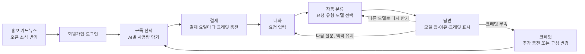

# Siempre PRD — AI 통합 구독 서비스 MVP

> 버전: PRD02 · 작성일 2026-11-05 · 작성자 김형민
> 수정 2026-11-09: MVP 범위에 회원가입·로그인 추가 (5-0, 6, 8-1), 크레딧 지급일을 결제일 기준 요일로 변경 (1-3, 4-1, 6), 페르소나 가설 추가 (2-2, 2-5)
> 근거: Figma `siempre` 파일의 **확정용** 페이지(서비스 화면 4개, 카드뉴스 6장). PRD01을 이 화면에 맞춰 고친 버전이다.

## 목차

1. 개요
2. 문제와 사용자
3. 입점 AI와 요금
4. 크레딧 정책
5. MVP 기능 요구사항
6. 사용자 흐름
7. 목표와 성공 지표
8. 범위와 리스크
9. 열린 질문

---

## 1. 개요

### 1-1. 서비스 정의

Siempre는 GPT, Qwen, Mistral 중 쓸 AI만 장바구니처럼 골라 담고, 한 대화창에서 요청마다 알맞은 모델이 자동으로 답하는 AI 통합 구독 서비스다.

- 담은 사용량은 **하나의 크레딧 지갑**으로 합쳐지고, 고른 AI 어디에나 나눠 쓴다.
- 가벼운 대화는 가장 싼 모델(Mistral)이 처리해 크레딧을 쓰지 않는다.

### 1-2. 핵심 메시지

"AI 구독, 이제 골라 쓰세요 — 안 쓰는 AI엔 0원."

### 1-3. PRD01에서 바뀐 점

| 항목 | PRD01 | PRD02 |
| --- | --- | --- |
| 입점 AI | ChatGPT, Claude, Gemini, 음성(ElevenLabs), 이미지 5종 | **GPT, Qwen, Mistral 3종** |
| GPT를 고른 이유 | — | 이미지 생성까지 되는 모델이 필요해서 Claude 대신 GPT를 넣음 |
| 묶음 할인 | 3개 이상 5% | **2개 5%, 3개 10%** |
| 크레딧 지급 | 매주 나눠 지급 | **매주 결제일 기준 요일에 충전**, 이월 없음, 추가 충전 가능 |
| 크레딧 차감 | 미정 | **요청 유형별 고정 차감**(1·2·5·19크레딧, 가벼운 대화는 무제한) |
| 화면 | 구독 구성, 결제, 통합 채팅 | **대화, 구독 선택, 크레딧, 관리자** |
| 가격 기준 | 공식 구독 대비 할인 | 2026년 11월 API 단가, 환율 ₩1,480 기준 |

---

## 2. 문제와 사용자

### 2-1. 해결할 문제

| 문제 |
| --- |
| AI를 따로 구독하면 매달 고정비가 쌓이는데 다 쓰지 못한다 |
| 다른 AI로 옮길 때마다 같은 말을 다시 붙여넣는다 |
| 어떤 AI를 쓸지 매번 고민한다 |

### 2-2. 타깃 사용자

여러 AI를 동시에 쓰는 **대학생, 1인 크리에이터, 마케터**(서비스 소개서 기준). 글·이미지·번역을 이어서 처리하는 직장인, 소상공인, 프리랜서, 온라인 판매자까지 넓혀 검증한다(2-5).

### 2-3. 핵심 사용자

글쓰기, 번역, 콘텐츠 기획을 혼자 맡아 **작업마다 AI를 바꿔 쓰는 1인 크리에이터·마케터**.

- 하는 일: 신메뉴 홍보 게시글, 쇼츠 대본, 상세페이지 카피, 영문 보도자료 번역 (대화 화면 예시)
- 원하는 것: 작업마다 맞는 AI가 알아서 답하고, 쓰는 만큼만 돈을 내는 것
- 지금의 불편: AI별 구독료가 겹치고, 탭을 오가며 같은 내용을 다시 붙여넣어야 한다

### 2-4. 대표 사용 시나리오

1. 인스타 게시글 3개를 요청한다 → 글쓰기로 분류돼 **GPT-6 Sol**이 답한다(5크레딧).
2. 1번 게시글을 영어로 번역해 달라고 한다 → 번역으로 분류돼 **Qwen3.7-Plus**가 이어서 답한다(1크레딧).
3. "고마워"처럼 가볍게 말한다 → **Mistral Small 4**가 답하고 크레딧은 차감되지 않는다.

### 2-5. 페르소나 (가설)

모두 가상 인물이며 사용자 인터뷰로 검증할 기획 가설이다. 실제 이용률이나 지불 의사를 뜻하지 않는다.

| 사용자 | 이어지는 작업 | 꼭 필요한 경험 | 검증 순서 |
| --- | --- | --- | --- |
| 1인 유튜버 | 대본 → 내레이션 → 썸네일 | 수정한 내용이 다음 결과물에도 이어짐, 수정할 때마다 드는 비용 확인 | 1 |
| 마케터 | 캠페인 카피 → 이미지 → 번역 | 브랜드 말투·행사 조건 유지, 반복 수정 비용 | 2 |
| 프리랜서 디자이너 | 고객 브리프 → 카피·시안 → 수정 | 이전 승인 조건 유지, 다시 받기 추가 차감 이해 | 2 |
| 대학생 | 자료 요약 → 이해 → 발표 초안 | 무료로 시작, 무료 한도와 추가 비용 안내 | 3 |
| 직장인 | 회의 메모 → 보고서 → 메일 | 항목·수치 누락 없음, 깊은 검토 선택 | 3 |
| 카페 운영자 | 홍보 문구 → 포스터 → 리뷰 답글 | 쉬운 구성 선택, 주간 소멸 안내, 모바일에서 이미지 내려받기 | 3 |
| 온라인 판매자 | 상품 설명 → 번역 → 문의 답변 | 숫자·단위 보존, 낮은 반복 비용 | 3 |

**공통으로 확인할 것**
- 앞 작업의 내용이 다음 AI로 넘어갈 때 다시 설명하지 않아도 되는가
- 보내기 전 예상 비용과 다시 받기의 추가 차감을 이해하는가
- 자동 모델 선택을 어느 단계에서 불안해하는가

첫 인터뷰는 1인 유튜버부터 진행하고, 마케터·프리랜서 디자이너로 작업 맥락 유지가 반복되는지 확인한다. 참여자는 최근 실제 작업에서 AI를 2개 이상 써 본 사람으로 한다.

---

## 3. 입점 AI와 요금

### 3-1. 입점 AI

| AI | 대화 모델 | 고난도 모델 | 강점 |
| --- | --- | --- | --- |
| GPT | GPT-6 Sol | GPT-6 Astra | 글쓰기 · 이미지 생성 |
| Qwen | Qwen3.7-Plus | Qwen3.7-Max | 가성비 · 다국어 |
| Mistral | Mistral Small 4 | Mistral Large 3 | 가장 저렴 |

### 3-2. 단계별 요금

월 기준, 부가세 포함. 2026년 11월 API 단가와 환율 ₩1,480 기준이다.

| AI | 라이트 | 스탠다드 | 헤비 |
| --- | --- | --- | --- |
| GPT | ₩8,900 (대화 150회, 고난도 5회) | ₩17,900 (300회, 10회) | ₩44,900 (700회, 30회) |
| Qwen | ₩2,900 (300회, 10회) | ₩7,900 (800회, 30회) | ₩19,900 (2,000회, 80회) |
| Mistral | ₩1,900 (500회, 20회) | ₩5,500 (1,500회, 50회) | ₩14,900 (4,000회, 150회) |

### 3-3. 묶음 할인

2개 담으면 5%, 3개 모두 담으면 10%.

### 3-4. 예시 구성

- GPT 스탠다드 ₩17,900 + Qwen 라이트 ₩2,900 + Mistral 스탠다드 ₩5,500 = ₩26,300 − 10% ₩2,630 = **월 ₩23,670, 매주 약 658크레딧**.
- GPT 스탠다드는 공식 ChatGPT Plus(약 ₩29,000)보다 매달 ₩11,100 싸다.

---

## 4. 크레딧 정책

### 4-1. 지급과 소멸

- 월 구독료만큼의 크레딧을 **매주 결제일과 같은 요일**에 채워 준다. 첫 주 크레딧은 결제 즉시 채우고, 그다음부터는 결제한 요일 0시(한국 시간)마다 충전한다. 예: 수요일에 결제하면 매주 수요일 0시.
- 사용자마다 충전 요일이 다르다. 결제일이 곧 그 사용자의 "한 주"의 시작이다.
- 남은 크레딧은 다음 충전 직전(충전 요일 전날 자정)에 사라지고 다음 주로 넘어가지 않는다.
- 구성을 바꿔 다시 결제해도 충전 요일은 처음 결제일 기준으로 유지한다.
- 크레딧이 모자라면 **추가 충전**할 수 있다.

### 4-2. 요청 유형별 차감

보내기 전에 입력창에서 예상 차감량을 보여 준다(예: "예상: 글쓰기 · 5크레딧").

| 요청 유형 | 기본 모델 | 대체 모델 | 차감 크레딧 |
| --- | --- | --- | --- |
| 가벼운 대화 | Mistral Small 4 | Qwen3.7-Plus | 무제한(하루 300회) |
| 요약·번역·다국어 | Qwen3.7-Plus | Mistral Small 4 | 1 |
| 대량 처리·가성비 고난도 | Mistral Large 3 | Qwen3.7-Max | 2 |
| 글쓰기·일반 질문 | GPT-6 Sol | Qwen3.7-Plus | 5 |
| 고난도 추론·코딩 | GPT-6 Astra | Qwen3.7-Max | 19 |

### 4-3. 비용 안전장치

- 요청 1건 원가가 **₩500**을 넘으면 더 저렴한 모델로 다시 보낸다.
- 사용자 1명의 하루 원가가 **₩3,000**을 넘으면 관리자에게 알린다.
- 가벼운 대화는 하루 **300회**까지.
- 요청 분류는 Mistral Small 4가 맡고, 공급사 장애 시 대체 모델로 자동 전환한다.

---

## 5. MVP 기능 요구사항

### 5-0. 회원가입·로그인

이메일과 비밀번호로 가입하고 로그인한다. 구독·크레딧·대화 기록이 회원 계정에 묶이므로 MVP에 포함한다.

| 요구사항 | 우선순위 |
| --- | --- |
| 이메일·닉네임·비밀번호로 회원가입한다. 필수 약관 동의를 받는다. | P0 |
| 이메일·비밀번호로 로그인하고 로그아웃한다. 로그인 상태가 유지된다. | P0 |
| 로그인하지 않은 사용자가 구독·대화·크레딧 화면에 들어오면 로그인 화면으로 보낸다. | P0 |
| 이미 가입된 이메일로 가입하려 하면 막지 않고 로그인 화면으로 안내한다. | P1 |
| 비밀번호는 해시로만 저장하고, 로그·주소·화면 어디에도 평문으로 남기지 않는다. | P0 |

### 5-1. 구독 선택(장바구니)

| 요구사항 | 우선순위 |
| --- | --- |
| AI 3종마다 안 씀·라이트·스탠다드·헤비 중 하나를 고른다. | P0 |
| 고를 때마다 장바구니의 항목, 묶음 할인, 월 결제액, 주간 크레딧이 바로 바뀐다. | P0 |
| AI 카드마다 공식 구독 대비 절약액을 보여 준다. | P0 |

### 5-2. 결제

| 요구사항 | 우선순위 |
| --- | --- |
| 장바구니 구성으로 월 구독을 결제한다. | P0 |

### 5-3. 대화

| 요구사항 | 우선순위 |
| --- | --- |
| 한 대화창에서 요청을 분류해 알맞은 모델로 보낸다. 모델이 바뀌어도 앞 대화 맥락을 이어받는다. | P0 |
| 답변마다 모델 칩(모델별 색), 선택 이유, 차감 크레딧을 보여 준다. 예: "글쓰기 요청이라 자동 선택 · 5크레딧" | P0 |
| "다른 모델로 다시 받기"로 같은 질문을 다른 모델에게 다시 받는다. | P0 |
| 입력창에 예상 요청 유형과 차감 크레딧을 미리 보여 준다. 파일 첨부 버튼이 있다. | P1 |
| 사이드바에 대화 기록(오늘·지난 7일), 이번 주 크레딧 막대, 요금제 링크, 구독 중인 AI 로고를 둔다. | P1 |

### 5-4. 크레딧

| 요구사항 | 우선순위 |
| --- | --- |
| 이번 주 남은 크레딧과 주간 지급량, 다음 충전일, 추가 충전 버튼을 보여 준다. | P0 |
| 내 구독 구성: AI별 구독 단계, 대화·고난도 모델과 월 이용 횟수, 월 요금, 묶음 할인 후 월 결제액을 보여 준다. | P0 |
| 이번 주 가벼운 대화 횟수, 요청 유형별 사용량, 최근 기록(시간·작업·모델·크레딧) 표를 보여 준다. | P1 |

### 5-5. 관리자

| 요구사항 | 우선순위 |
| --- | --- |
| 베타 지표 5개(7-1)를 본다. | P1 |
| 라우팅 규칙 표를 보고 규칙별로 켜고 끈다. | P1 |
| 비용 안전장치 값(4-3)과 손익 기준선(7-2)을 본다. | P1 |

---

## 6. 사용자 흐름

---

## 7. 목표와 성공 지표

### 7-1. 베타 지표

베타는 아직 시작 전이라 실측값은 없다. 관리자 화면의 목표값은 다음과 같다.

| 지표 | 목표 | 확인하려는 것 |
| --- | --- | --- |
| 다른 모델로 다시 받기 비율 | 10% 이하 | 자동 라우팅을 믿는지 |
| 4주 차 재방문율 | 30% 이상 | 계속 쓰는지 |
| 무료→유료 전환율 | 5% | 돈을 내는지 |
| 크레딧 사용률 | 50~70% | 수익 구조가 맞는지 |
| 유료 1인당 월 API 원가 | ₩13,000 이하 | 원가가 맞는지 |

### 7-2. 손익 기준선

손익 추정 시트 기본 시나리오 기준이다.

| 항목 | 값 |
| --- | --- |
| 손익분기 유료 가입자 | 약 6,900명 |
| 유료 1인 월 API 원가 | ₩13,000 이하 |
| 크레딧 사용률 | 65% 가정 |
| 무료 1인 월 원가 | ₩100 가정 |

---

## 8. 범위와 리스크

### 8-1. 범위 밖

- 소셜 로그인, 비밀번호 찾기 메일, 휴대폰 본인인증 (MVP 회원가입·로그인은 이메일 방식만)

- 음성 생성(ElevenLabs) 등 3종 외 AI
- 한 질문에 여러 모델이 동시에 답하는 병렬 비교
- 다른 서비스에 들어가는 플러그인 형태

### 8-2. 리스크

- 크레딧 사용률이 100%에 가까워지면 적자가 난다. 주간 충전과 이월 없음이 수익 구조의 핵심이다.
- 모델을 바꿀 때 앞 대화 기록을 새 모델에 다시 보내야 해서 토큰 비용이 늘어난다.
- GPT-6 Astra(19크레딧)를 많이 쓰는 사용자는 원가가 빠르게 오른다. 요청당 ₩500 상한이 이를 막는 장치다.
- 국내에는 여러 AI를 무료로 모은 서비스(뤼튼)가 있다. 차별점은 자동 라우팅과 쓰는 만큼 내는 구조다.

---

## 9. 열린 질문

### 9-1. 제품·정책

- [ ] **이미지 생성의 라우팅 규칙과 차감 크레딧이 없다.** GPT를 넣은 이유가 이미지 생성인데, 라우팅 표에 이미지 요청 유형이 빠져 있다.
- [ ] 자동 라우팅이 구독하지 않은 AI가 더 맞다고 판단하면 어떻게 하나? (추천만 보여 줄지, 구독 추가를 제안할지)
- [ ] 주 타깃은 헤비 유저인가, 라이트 유저인가?

### 9-2. 가격·원가

- [ ] **GPT 가격 근거:** GPT 단계별 가격은 PRD01 시안 가격을 옮겨 온 것이라, "API 단가 기준"으로 다시 계산해야 한다.
- [ ] **요청당 차감 크레딧(1·2·5·19)이 실제 API 원가와 맞는지** 검증이 필요하다.

### 9-3. 표기·브랜딩

- [ ] **서비스 이름:** 화면에 [Siempre]처럼 대괄호로 표기돼 있어 확정 여부가 불분명하다.
- [ ] **표기 통일:** GPT 강점이 구독 화면에는 "글쓰기 · 이미지 생성", 카드뉴스 3장에는 "글쓰기·코딩 만능"으로 다르다.
- [ ] **카드뉴스 1장 비교 대상:** 공식 구독 5개(ChatGPT, Claude, Google AI, 이미지 AI, ElevenLabs) 합계와 비교하는데, Siempre는 3종만 제공한다. 같은 조건의 비교인지 정리가 필요하다.
